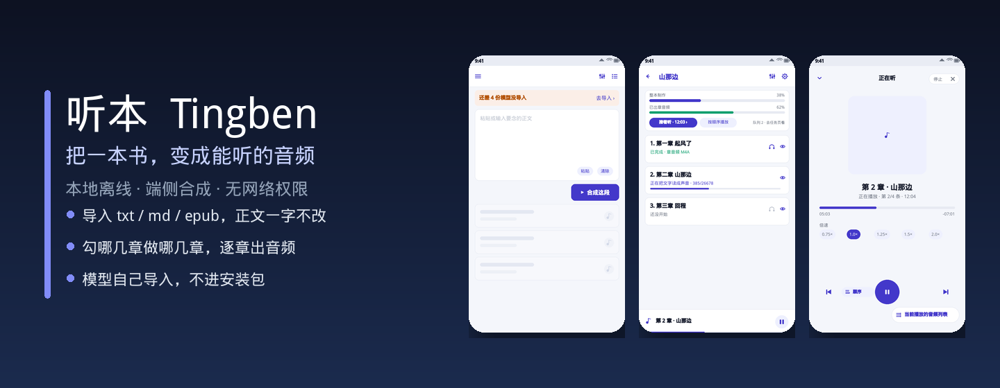
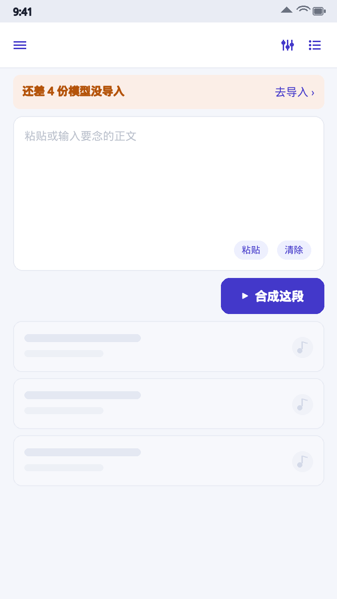
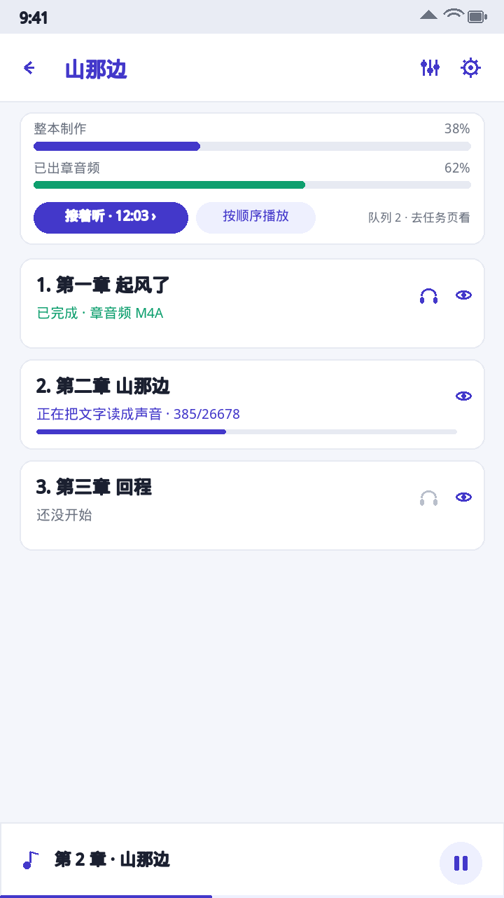
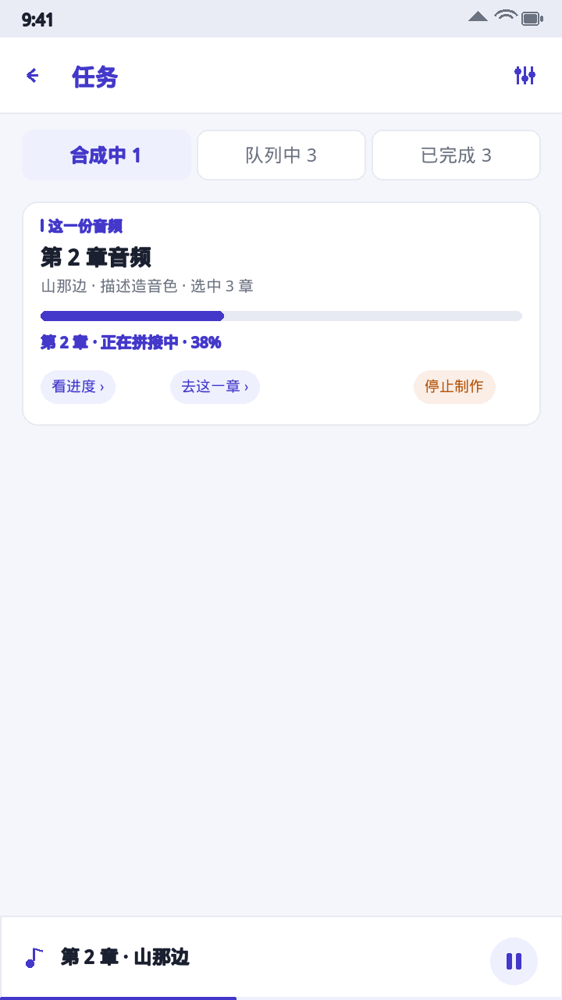
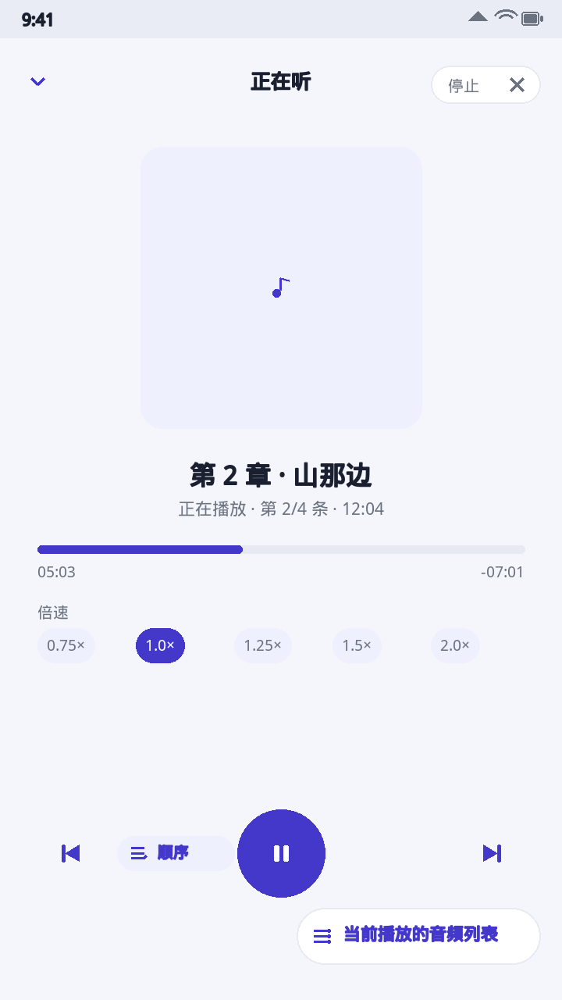
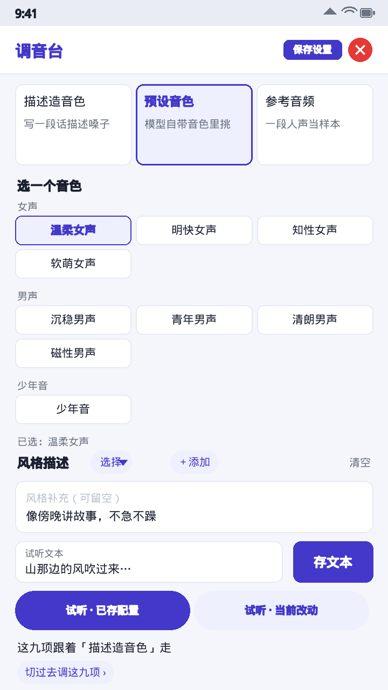
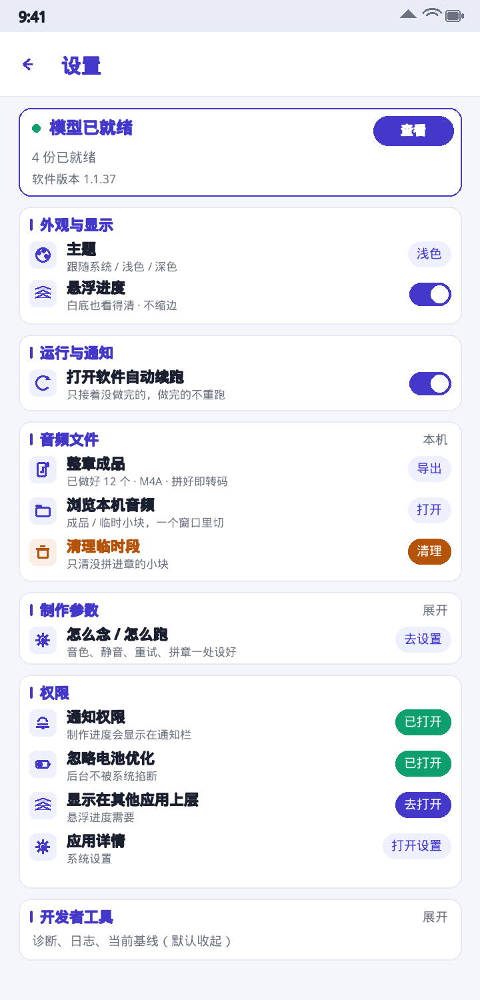

<div align="center">
  
</div>

# 听本 · Tingben

> 本地离线把 txt / md / epub 变成能听的音频。端侧合成、正文一字不改、模型自己导入、App 无网络权限。

[](https://github.com/zjh1934/tingben/releases/latest)
[](https://github.com/zjh1934/tingben/actions/workflows/ci.yml)
[](https://www.android.com/)
[](LICENSE)

[下载](#下载) · [看看界面](#看看界面) · [功能](#功能) · [30-秒开始](#30-秒开始) · [模型文件](#模型文件后导入不进包) · [技术栈](#技术栈与架构) · [文档](#文档) · [更新记录](#更新记录) · [如实说](#如实说) · [参与](#参与) · [许可](#许可)

## 为什么做这个

想听一本本地的小说，不想把正文上传到任何服务器、也不想装几个 G 的模型进 APK。
听本把整条链路都放在手机里：导入书 → 勾要做的章 → 逐段端侧合成 → 这一章的小块一做完就拼成这一章的音频。
没有账号、没有联网、没有文本改写，正文一个字都不动。App 不含 `INTERNET` 权限，只支持 arm64-v8a 机型。

## 下载

**当前版本 `1.1.38`**（Android 8.0+ / arm64-v8a，固定签名，覆盖安装保留模型与已做好的音频）：

```
https://github.com/zjh1934/tingben/releases/download/v1.1.38/app-debug.apk
```

永远是最新版的固定直链：

```
https://raw.githubusercontent.com/zjh1934/ting-ben-apk/main/app-debug.apk
```

> 平台解析器读不了 GB 级二进制时会报「资源解析服务请求失败」，不是坏链，用浏览器打开即可。

## 看看界面

下面的图按当前代码画出界面形态（书名、段数、进度是模拟数据），不是真机截屏。

<p align="center">
  
  
</p>
<p align="center">
  
  
</p>
<p align="center">
  
  
</p>

更多形态（书架、制作中的小块、调音台三模式、设置、模型、播放列表等）在 [`docs/screenshots/`](docs/screenshots/) 与 [`docs/界面形态清单.md`](docs/界面形态清单.md)。

## 功能

| 能力 | 说明 |
|---|---|
| 离线端侧合成 | 无 `INTERNET` 权限；一套 Qwen3-TTS 模型在手机里跑，合成不联网 |
| 正文不改 | 不做改写、不做角色切分；导入 txt / md / epub 或粘贴文字建书 |
| 按章制作 | 设置里定「怎么做」，目录页勾「做哪几章」，顺着勾选一次做完 |
| 逐章出成品 | 这一章小块做完立刻拼成一个音频，转 64kbps 单声道 AAC-LC M4A，校验通过才删内部 WAV；失败留手动另存兜底 |
| 三种音色模式 | 描述音色（预设的详细描述真正喂给模型）/ 九种中文预设音色 / 参考音频克隆 |
| 任务页 | 合成中 · 队列中 · 已完成三段，一条就是一份音频（一章或首页粘贴合成的一段） |
| 全局播放器 | 底部常驻条上滑展开、下滑跟手收起；顺序 / 随机 / 循环三态；播放列表按当前上下文切 |
| 进度与续跑 | 制作中小块转圈、章名盖「正在拼接中 / 正在转码中」；长任务逐块落盘，中断可续 |

## 30 秒开始

1. 装上面的 APK → 设置 → **模型**：按缺件提示逐份导入（1 份共用底座 + 至少 1 份模式主文件）。
2. 首页粘贴文字点「合成这段」，或右上角 **＋** 导入 txt / md / epub；左滑抽屉里能找到书。
3. 进书 → 目录页勾章 → 底部菜单「制作选中 N 章」。制作参数在设置页定，声音在调音台里调。

完整步骤与常见问题见 [使用指南](docs/使用指南.md) 与 [FAQ](docs/FAQ.md)。

## 模型文件（后导入，不进包）

| 文件 | 角色 |
|---|---|
| `qwen-tokenizer-12hz-Q8_0.gguf` | 共用底座，三种模式都要 |
| `qwen-talker-1.7b-voicedesign-Q8_0.gguf` | 自然语言描述造音色 |
| `qwen-talker-1.7b-customvoice-Q8_0.gguf` | 预设音色编号 + 语气指令 |
| `qwen-talker-1.7b-base-Q8_0.gguf` | 一小段参考音频克隆 |

上游：`Serveurperso/Qwen3-TTS-GGUF`（国内可把域名换成 `hf-mirror.com`）。
能调什么以随包 [`app/src/main/cpp/qwen.h`](app/src/main/cpp/qwen.h) 与 [模型调教逻辑](docs/01_音频模型调教逻辑.md) 为准。

## 技术栈与架构

Android · Kotlin + Jetpack Compose（单 Activity）· JNI/C++ · minSdk 26 / targetSdk 35 · 仅 arm64-v8a。
制作走前台服务逐段落盘，播放走常驻条与全屏浮层，四类 JSON 共用原子落盘。
源码地图见 [STATUS.md](STATUS.md#分层与守恒)，动代码前先读 [现行契约](docs/00_现行契约.md)。

## 文档

| 想找什么 | 去哪 |
|---|---|
| 装好之后怎么用 | [使用指南](docs/使用指南.md) · [FAQ](docs/FAQ.md) |
| 每个版本改了什么 | [CHANGELOG.md](CHANGELOG.md) · [Releases](https://github.com/zjh1934/tingben/releases) |
| 现在是什么 / 接下来做什么 | [STATUS.md](STATUS.md) · [ROADMAP.md](ROADMAP.md) |
| 契约、模型、排期 | [docs/00_现行契约.md](docs/00_现行契约.md) · [docs/修复清单_按优先级.md](docs/修复清单_按优先级.md) |
| 第三方许可 | [docs/THIRD_PARTY_NOTICES.md](docs/THIRD_PARTY_NOTICES.md) |

## 更新记录

版本真值只在根目录 [`version.txt`](version.txt)。Gradle、CI 的 Release 标签与名称都从它读；
每次发版修订号加一，`README` / `STATUS.md` / `ROADMAP.md` / `CHANGELOG.md` 一起对齐。
发版流程：本地收口 → rc 分支跑全套静态守门 + Gradle 真编译 → 绿了才快进 main → 自动发布 Release 并同步固定直链。

完整记录见 [CHANGELOG.md](CHANGELOG.md)，最新一版见 [Releases](https://github.com/zjh1934/tingben/releases/latest)。

## 如实说

- 静态自检绿 ≠ 编译过 ≠ 好用；沙盒无 Android SDK，真编译由 CI 完成，手感要装包后才知道。
- 界面截图是按代码绘制的形态示意，不是真机截屏；模拟数据不对应任何真实书目。
- 点停止后要等当前那一小段推理跑完才真正结束；模型出声本身较慢，不是界面卡死。
- 平台解析器打不开 APK 二进制时请用浏览器，不是坏链。

## 参与

欢迎提 [Issue](https://github.com/zjh1934/tingben/issues) 或 PR。动手前请看 [CONTRIBUTING.md](CONTRIBUTING.md)；
安全与隐私问题见 [SECURITY.md](SECURITY.md)。日志不落正文、书名与音色描述，提交问题时也请不要贴这些内容。

## 许可

[MIT](LICENSE) © 2026 zjh1934。移植改写与上游模型的版权声明另见 [第三方声明](docs/THIRD_PARTY_NOTICES.md)。

## 致谢

Qwen3-TTS 与其 GGUF 量化生态、llama.cpp、以及 `reference/` 里参考过的开源实现。
